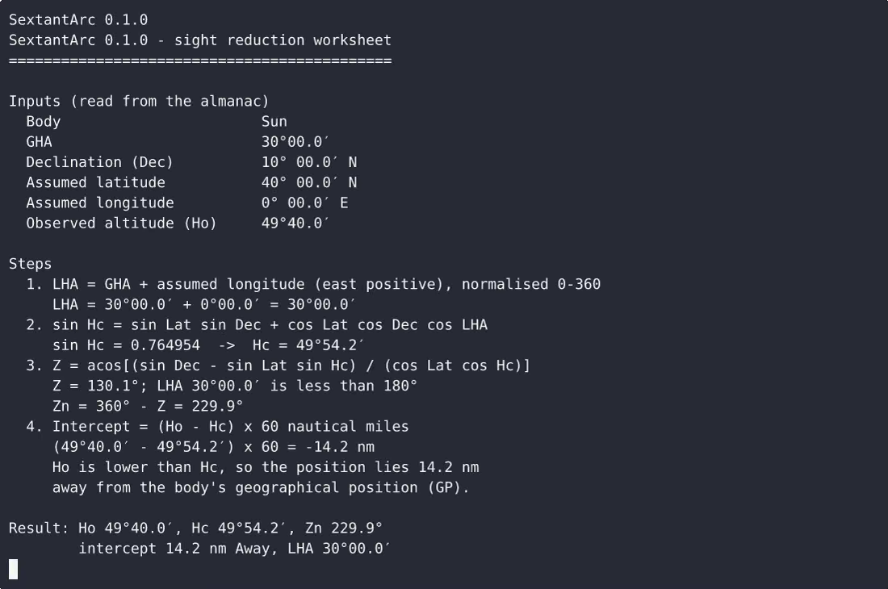
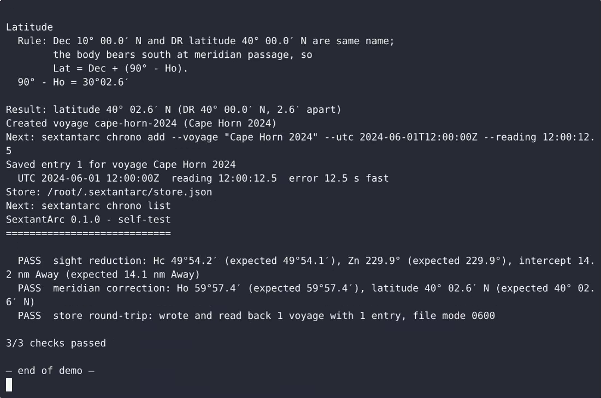

# SextantArc — complete Full-stack app command-line tool example app

**SextantArc** is a free, open-source command-line tool written in Full-stack app. SextantArc is a single-file, standard-library-only Python command-line tool for offshore celestial navigation work done offline. Every SextantArc file — code, design, seeded demo data — ships in this repository under the Apache-2.0 license. Self-host it, or [remix SextantArc on cenius.ai](https://cenius.ai/marketplace/p/sextantarc?ref=gh&utm_campaign=sextantarc-webapp) to get a custom build with full rebrand rights.


[](LICENSE)  [](https://cenius.ai)

[](https://cenius.ai/marketplace/p/sextantarc?ref=gh&utm_campaign=sextantarc-webapp)

> **▶ [Open & edit in cenius.ai](https://cenius.ai/marketplace/p/sextantarc?ref=gh&utm_campaign=sextantarc-webapp)** — one click to an editable workspace: describe changes in plain English, get an instant preview, one-click deploy and host. Modifications made on the platform come with full rebrand & relicense rights.

_Local clone? See [Quick start](#quick-start) below. cenius.ai is the zero-setup path._

## Demo


▶ **[See it in action](https://cenius.ai/marketplace/p/sextantarc?ref=gh&utm_campaign=sextantarc-webapp)** — full demo on the project page · [MP4](.github/media/demo.mp4)

## Screenshots

 

## Features

- Sight reduction worksheet
- Meridian altitude correction table
- Chronometer drift notes per voyage
- CLI shell, parsing and validation
- Worksheet export to a text file

## Quick start

```bash
./install.sh   # installs dependencies + seeds demo data
```

See [`INSTALL.md`](INSTALL.md) for full setup and usage instructions.

## Usage guide

Every command is flags only - nothing prompts, so a run is scriptable and can
be pasted into a log. Angles accept `45°12.6'N`, `45 12.6 N` and `-45.21`;
latitude takes N/S, longitude E/W, GHA 0–360° and declination 0–90°.

Exit codes: `0` ok, `1` a `--self-test` check failed, `2` usage/validation,
`3` storage error.

---

### 1. Reduce a sight to an intercept

You read GHA and declination from the almanac, correct the observed altitude
on paper, and let SextantArc do the spherical trigonometry:

```
python3 sextantarc.py reduce \
    --body Sun \
    --gha 30 \
    --dec "10°00.0'N" \
    --lat "40°00.0'N" \
    --lon 0 \
    --ho "49°40.0'"
```

What you get, in order:

1. an echo line for every parsed input, so a transposed digit is visible
   before you trust the numbers (`45°12.6'N` comes back as `45° 12.6′ N`);
2. step 1 - LHA = GHA + assumed longitude, normalised to 0–360°;
3. step 2 - `sin Hc = sin Lat sin Dec + cos Lat cos Dec cos LHA` with the
   value of sin Hc printed beside Hc;
4. step 3 - the azimuth angle Z and the `LHA < 180 -> 360 - Z` rule that
   turns it into Zn;
5. step 4 - the intercept `(Ho - Hc) x 60` in nautical miles, labelled
   Toward or Away with the reason in words;
6. a one-line result you can copy into the plot.

Assumed longitude is east positive: `--lon "120°30.0'W"` is `-120.5`.
Longitude past 180° is rejected, so use the hemisphere letter.

Write the same text to the ship's records:

```
python3 sextantarc.py reduce --gha 30 --dec "10°00.0'N" --lat "40°00.0'N" \
    --lon 0 --ho "49°40.0'" --export sight-sheet.txt
```

_Full guide: [`USAGE.md`](USAGE.md)_

## Architecture

Full-stack app project, delivered as a complete runnable codebase (22 files). Top-level layout: `tests/`. Dependency management and data seeding are both handled by `./install.sh` — run it once, then start the server. For environment-specific setup, see [`INSTALL.md`](INSTALL.md).

## FAQ

### What's the quickest way to self-host SextantArc?

It runs entirely on your own machine. Clone, run `./install.sh`, and follow [`INSTALL.md`](INSTALL.md) — the whole stack is in this repo, no external dependencies required.

### What if I want to add features to SextantArc without coding?

Non-developers can use [cenius.ai](https://cenius.ai/marketplace/p/sextantarc?ref=gh&utm_campaign=sextantarc-webapp) to make changes. Describe your goal in everyday language and the platform delivers an updated, ready-to-run project — zero coding on your part.

### Is it possible to white-label SextantArc for a client?

Yes. The MIT license lets you remove the original branding and ship under your own name. For a guided approach, [remix it on cenius.ai](https://cenius.ai/marketplace/p/sextantarc?ref=gh&utm_campaign=sextantarc-webapp): you get a fresh build with full rebrand and relicense rights.

### What is SextantArc built with?

SextantArc is a Full-stack app application — and this repository holds the complete, runnable source, not a stripped-down sample. Highlights include chronometer drift notes per voyage.

### What license does SextantArc use?

Confirmed free for commercial use — MIT terms let you incorporate, resell, or ship it in any product. [LICENSE](LICENSE).

## License & rebranding

Released under the [Apache License 2.0](LICENSE) (© 2026 Cenius AI) — free for personal and commercial use. The Cenius name/logo are trademarks (see NOTICE).

**Need a customized version?** [Remix this app on cenius.ai](https://cenius.ai/marketplace/p/sextantarc?ref=gh&utm_campaign=sextantarc-webapp) — modifications made on the platform come with **full rebrand & relicense rights** over your derivative.

## Built with cenius.ai

This entire application — code, design, seeded demo data — was generated on **[cenius.ai](https://cenius.ai)** from a plain-English description.

- 🚀 [Build your own app on cenius.ai](https://cenius.ai)
- 🎛️ [Remix SextantArc on the marketplace](https://cenius.ai/marketplace/p/sextantarc?ref=gh&utm_campaign=sextantarc-webapp) — open it in a workspace, prompt for changes, and ship your own version.

More open-source apps: [the Cenius-ai catalog](https://github.com/Cenius-ai) · [showcase index](https://github.com/Cenius-ai/showcase)
